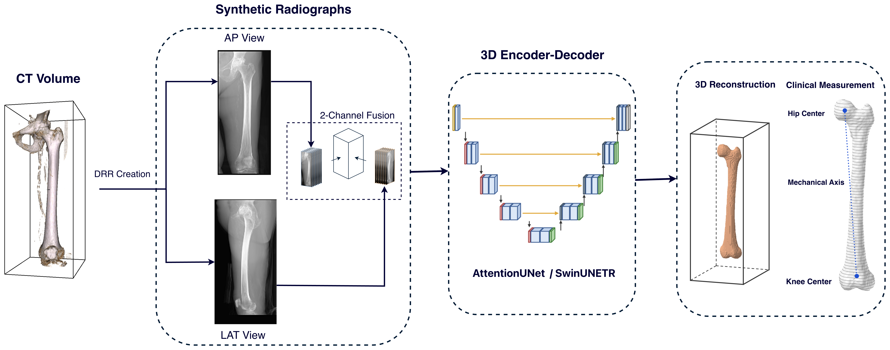

# Biplanar-xray-to-3d-femur

Recovering the femoral mechanical axis (hip centre → knee centre) from two synthetic X-rays (AP + lateral)
via 3D femur reconstruction. Compares AttentionUNet (1.5M params) and SwinUNETR (62M) on HFValid
(101 CTs, 5-fold CV) with an external test on VSD.



**Result:** with the same training recipe, both models recover the axis to about 0.5° on HFValid and 0.6–0.7° on
VSD, so the small CNN matches the transformer. The remaining error is set mainly by locating the femoral head,
not by the architecture, the knee rule, or Dice; a direct 2D landmark baseline lands in the same range, so 3D
reconstruction is not required for this particular measurement. Full method and results:
[report](https://ashishkpokharel.com.np/papers/femur-mechanical-axis.pdf).

## Inference

```bash
pip install -e .
python inference/predict.py --ap ap.png --lat lat.png --side L
```

Saves the 3D femur mask, hip/knee centres and axis, and a preview image. Weights download automatically from
[Hugging Face](https://huggingface.co/ayyp/biplanar-xray-to-3d-femur). Inputs must be in the project's DRR format
(AP 256×96, LAT 256×128 pixels at 2 mm, hip at the top).

No GPU needed. It runs on a Raspberry Pi 4, the computer that costs less than the X-ray :) about 22 s per model, under 2 minutes for all five.

```bash
# on your laptop: export the models (weights/ is filled by the predict.py run above)
pip install onnx
python deploy/export_onnx.py --weights weights --out onnx
scp -r onnx pi@<pi-ip>:biplanar-xray-to-3d-femur/

# on the Pi (64-bit Pi OS, repo cloned and installed with pip install -e .)
pip install onnxruntime
python deploy/pi_demo.py --ap ap.png --lat lat.png --onnx onnx
```

The export also works on the Pi itself, it just takes about 6 minutes per model.

## Training

```bash
python preprocessing/preprocess_hfvalid.py /path/to/HFValid_Collection_v3 preprocessed
cp configs/split.json preprocessed/
python training/train.py --config configs/attnC.yaml --data preprocessed
python training/train.py --config configs/swinC.yaml --data preprocessed
```

Trains the 5 cross-validation folds of each model; `--fold 0` trains one. All hyperparameters (architecture,
epochs, learning rate, augmentation) are in `configs/*.yaml`. Checkpoints go to `checkpoints/` and an
interrupted run resumes from the last epoch. Both models together take about 30 GPU-hours on T4s
(≈9.5 h for AttentionUNet, ≈21.5 h for SwinUNETR).

## Evaluation

```bash
python evaluation/evaluate.py --data preprocessed --ckpt checkpoints
python evaluation/robustness.py --data preprocessed --ckpt checkpoints
python preprocessing/prepare_vsd.py --out vsd
python evaluation/evaluate_vsd.py --vsd vsd --data preprocessed --ckpt checkpoints
python evaluation/compare.py results/hfvalid_cv.csv --a attnC --b swinC
```

Cross-validation, robustness and VSD external test write per-case CSVs to `results/`; `compare.py` runs the
paired statistics. `bash run_pipeline.sh /path/to/HFValid_Collection_v3` runs everything from preprocessing
to statistics.

## Landmark analysis

What limits the axis is studied separately from the reconstruction. These were run on Kaggle (paths under
`/kaggle/input`); each notebook's first cell lists the datasets it expects.

- `notebooks/landmark_3d_learned.ipynb` — a learned 3D landmark extractor (U-Net heatmaps) against the
  rule-based one, on true and predicted masks.
- `notebooks/landmark_2d_baseline.ipynb` and `landmark_2d_nested_selection.ipynb` — a 2D baseline that
  triangulates landmarks from the two views, with the epoch chosen on the held-out fold (0.46°) and on an inner
  split the outer fold never enters (0.67°); the 3D models (0.53–0.55°) sit between the two, so the internal
  comparison turns on how the checkpoint is selected rather than on 2D vs 3D.
- `notebooks/axis_error_geometry.ipynb` — splits each landmark error into along- and across-axis parts.
- `evaluation/observer_variability.py` — expert-vs-expert and single-vs-consensus disagreement from the VSD
  raters, the scale the errors are compared against. Needs the `Rater1.mat`–`Rater5.mat` files from
  [VSDFullBodyBoneModels](https://github.com/MCM-Fischer/VSDFullBodyBoneModels).

## Data

- HFValid: [amsacta.unibo.it/8431](https://amsacta.unibo.it/8431/) (CC BY 4.0)
- VSD: [doi.org/10.5281/zenodo.8302448](https://doi.org/10.5281/zenodo.8302448) (CC BY-NC-SA 4.0), with expert
  landmarks from [VSDFullBodyBoneModels](https://github.com/MCM-Fischer/VSDFullBodyBoneModels);
  both downloaded by `preprocessing/prepare_vsd.py`
